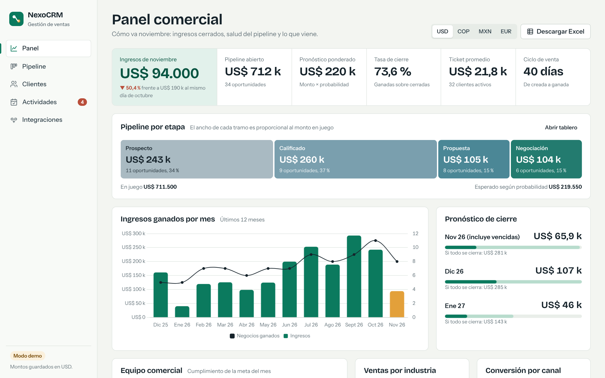
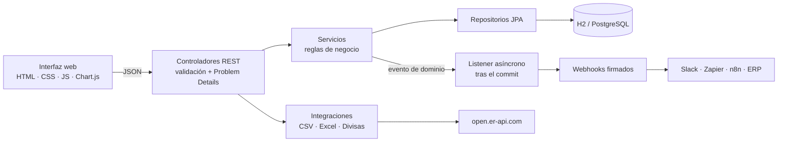
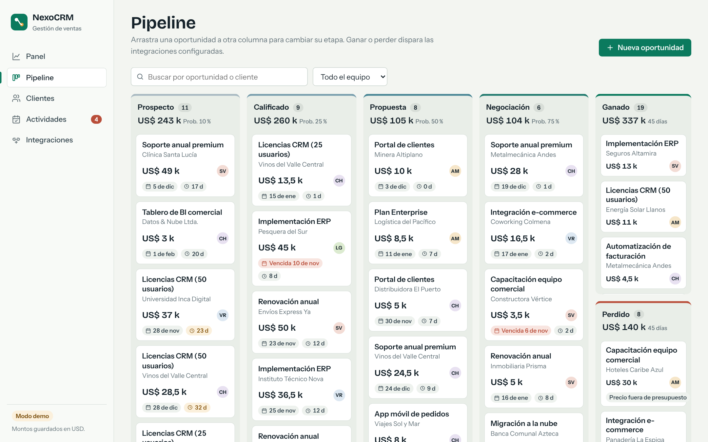
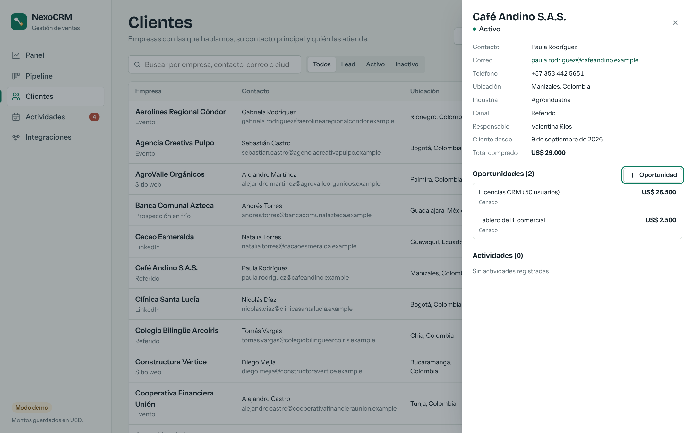
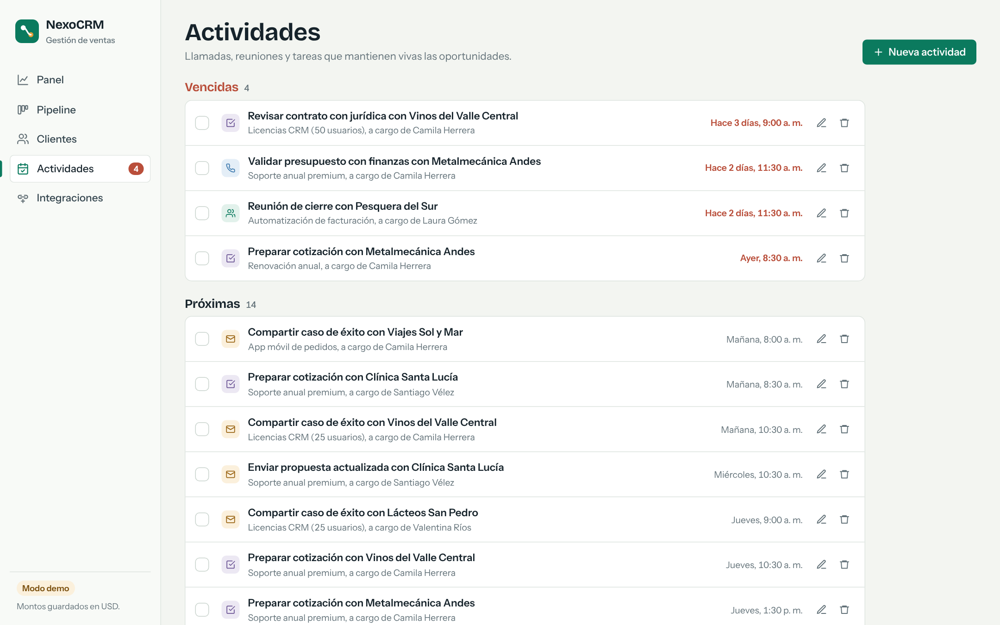
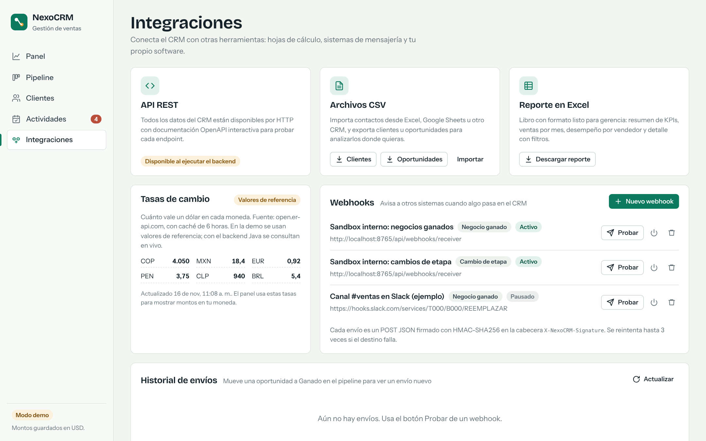
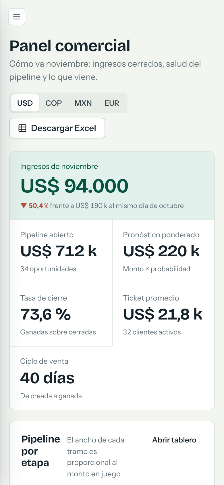

<div align="center">


# NexoCRM

**CRM de gestión de ventas** con pipeline visual, analítica comercial e integraciones reales.
Construido con Java 21 y Spring Boot 3.

[](https://github.com/jgbeli34/nexocrm/actions/workflows/ci.yml)


**[Probar la demo en vivo](https://jgbeli34.github.io/nexocrm/)**: funciona en el navegador, sin instalar nada.



</div>

## Qué resuelve

Un equipo comercial necesita saber tres cosas cada mañana: **cuánto vendimos, qué está por cerrarse y qué hay que hacer hoy**.
NexoCRM reúne clientes, oportunidades y actividades en un solo lugar y convierte esos datos en indicadores accionables:

- **Panel analítico**: ingresos del mes comparados con el mismo corte del mes anterior, pipeline abierto y ponderado, tasa de cierre, ticket promedio, ciclo de venta, ranking del equipo frente a su meta, ventas por industria, conversión por canal y pronóstico de cierre a 3 meses.
- **Pipeline Kanban**: arrastra oportunidades entre etapas; la probabilidad se actualiza sola, se alerta lo vencido y lo estancado (más de 21 días en la misma etapa) y perder un negocio exige registrar el motivo.
- **Clientes**: búsqueda, filtros, paginación y ficha con historial de compras y actividades.
- **Actividades**: agenda de llamadas, reuniones, correos y tareas agrupadas en vencidas, hoy y próximas.
- **Multimoneda**: los montos se guardan en USD y se muestran en COP, MXN o EUR con tasas de cambio en vivo.

## Integraciones

| Integración | Qué hace | Dónde está |
|---|---|---|
| **API REST + OpenAPI** | Todos los recursos expuestos por HTTP, documentados con Swagger UI | `/swagger-ui.html` |
| **CSV** | Importa clientes validando fila por fila (reporta errores y duplicados sin abortar) y exporta clientes u oportunidades con BOM UTF-8 para Excel | `CsvService` |
| **Excel (.xlsx)** | Reporte gerencial con 4 hojas: KPIs, ventas por mes con fórmulas, vendedores y detalle con filtros y paneles fijos | `ExcelReportService` (Apache POI) |
| **Tasas de cambio** | Consume una API pública con timeout, caché en memoria de 6 h y valores de respaldo si el proveedor falla | `ExchangeRateService` |
| **Webhooks salientes** | Al ganar, perder o mover un negocio envía un POST firmado con **HMAC-SHA256** (como Stripe o GitHub), con reintentos y bitácora de entregas | `WebhookService` |
| **Receptor sandbox** | Endpoint que recibe los webhooks y verifica la firma, para probar sin servicios externos | `/api/webhooks/receiver` |

Los webhooks se disparan con **eventos de dominio** de Spring publicados tras confirmar la transacción (`@TransactionalEventListener(AFTER_COMMIT)`) y se envían de forma **asíncrona**, así un sistema externo lento nunca bloquea al usuario ni se notifican cambios que luego se revierten.

## Arquitectura



```
src/main/java/com/nexocrm
├── domain/          Entidades JPA y enums (etapas con probabilidad por defecto)
├── repository/      Spring Data JPA con consultas JPQL y EntityGraph (sin N+1)
├── service/         Reglas de negocio y AnalyticsService (cálculo puro y testeable)
├── integration/     csv · excel · exchange · webhook
├── web/             Controladores REST, DTOs (records) y manejo global de errores
└── config/          Propiedades tipadas, OpenAPI y datos de demostración
```

**Decisiones de diseño**

- **Cálculo analítico como función pura**: `AnalyticsService.buildDashboard(...)` recibe datos y una fecha de referencia, por lo que se prueba con tests unitarios sin base de datos.
- **Comparación justa a mitad de mes**: el crecimiento compara contra el mismo día del mes anterior (MTD vs. MTD), no contra el mes completo.
- **DTOs como `record`** y `open-in-view` desactivado: la capa web nunca toca entidades perezosas.
- **Errores RFC 9457 (Problem Details)** con mensajes en español por campo, que la interfaz muestra junto a cada input.
- **Datos demo deterministas**: semilla fija y fechas relativas a hoy, así el panel siempre tiene 12 meses de historia.

## Capturas

| Pipeline | Clientes |
|---|---|
|  |  |
| **Actividades** | **Integraciones** |
|  |  |

<p align="center"></p>

## Cómo ejecutarlo

**Requisitos:** Java 21 y Maven 3.9+ (o solo Docker).

```bash
git clone https://github.com/jgbeli34/nexocrm.git
cd nexocrm
mvn spring-boot:run
```

Abre <http://localhost:8080>. La base H2 en memoria se llena con datos de demostración en cada arranque.

| Recurso | URL |
|---|---|
| Aplicación | http://localhost:8080 |
| Swagger UI | http://localhost:8080/swagger-ui.html |
| Consola H2 | http://localhost:8080/h2-console (JDBC `jdbc:h2:mem:nexocrm`, usuario `sa`) |
| Salud | http://localhost:8080/actuator/health |

**Con Docker y PostgreSQL:**

```bash
docker compose up --build
```

**Tests:**

```bash
mvn verify
```

Incluye pruebas unitarias del cálculo de KPIs y de la firma HMAC (con vector de referencia) y pruebas de integración con MockMvc para validación, reglas de negocio, importación CSV, exportación a Excel y el respaldo de tasas de cambio.

Para probar la importación hay un archivo de ejemplo en [`docs/clientes-ejemplo.csv`](docs/clientes-ejemplo.csv) con filas válidas e inválidas.

## API principal

| Método | Ruta | Descripción |
|---|---|---|
| `GET` | `/api/analytics/dashboard` | KPIs, series y rankings del panel |
| `GET` `POST` | `/api/customers` | Buscar (q, status, page, size, sort) y crear clientes |
| `PUT` `DELETE` | `/api/customers/{id}` | Editar o eliminar |
| `GET` `POST` | `/api/deals` | Listar (q, stage, ownerId, customerId) y crear oportunidades |
| `PATCH` | `/api/deals/{id}/stage` | Cambiar etapa; dispara webhooks |
| `GET` `POST` | `/api/activities` | Listar y crear actividades |
| `PATCH` | `/api/activities/{id}/toggle` | Completar o reabrir |
| `GET` `POST` | `/api/integrations/csv/customers` | Exportar o importar clientes |
| `GET` | `/api/integrations/reports/sales.xlsx` | Reporte en Excel |
| `GET` | `/api/integrations/exchange-rates` | Tasas de cambio desde USD |
| `GET` `POST` | `/api/integrations/webhooks` | Suscripciones; `POST /{id}/test` envía una prueba |

Ejemplo de webhook recibido:

```http
POST /tu-endpoint
X-NexoCRM-Event: DEAL_WON
X-NexoCRM-Signature: sha256=5f1c…
Content-Type: application/json

{ "event": "DEAL_WON", "occurredAt": "2026-11-16T15:42:10Z", "data": { "title": "Plan Enterprise", "amount": 32000, … } }
```

## Demo sin backend

La carpeta `static/` se publica en GitHub Pages con un **backend simulado en el navegador** (`js/demo/mock-api.js`) que implementa los mismos endpoints y reglas que la API Java. Se activa automáticamente en `github.io` o agregando `?demo` a la URL. El reporte en Excel y Swagger solo están disponibles con el servidor Java.

## Stack

Java 21 · Spring Boot 3.5 (Web, Data JPA, Validation, Actuator) · Hibernate · H2 · PostgreSQL · springdoc-openapi · Apache POI · Apache Commons CSV · JUnit 5 · MockMvc · AssertJ · JavaScript (módulos ES) · Chart.js · Docker · GitHub Actions · GitHub Pages

## Próximos pasos

- Autenticación con Spring Security y roles (vendedor / gerente)
- Migraciones con Flyway
- Envío de correos de recordatorio para actividades vencidas
- Integración con Google Calendar

## Autor

Proyecto de portafolio de **[jgbeli34](https://github.com/jgbeli34)**. Licencia MIT.
